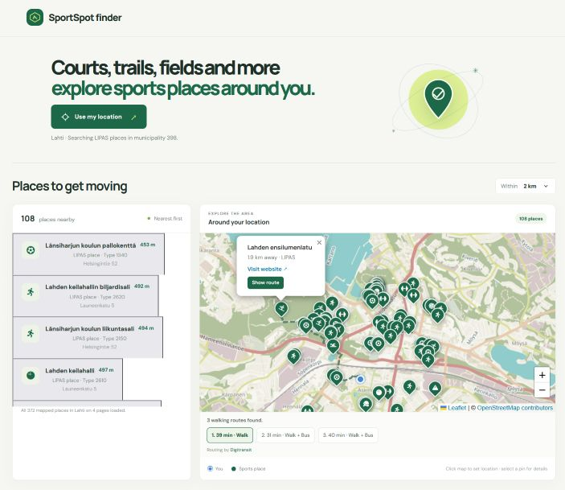

# SportSpot finder

 SportSpot finder is a static web app for finding nearby sports facilities in Finland. It loads facility data from the LIPAS API, displays facilities on a Leaflet map, and can request  routes from a chosen location to a facility using Digitransit.

The application is made for personal use. The original purpose was avoid hotel death by finding new training places nearby. Therefore, the page is static and intended for use on local computer by simply clicking index.html file. 
Please note that the settings are visible to the user. Do not set the Digitransit subscription key if anyone else has access to the application. One needs to develop a proper backend if the site is made public

## Run locally

Open `index.html` in a browser. The page loads `config.js` as a regular script, so loading the app configuration itself does not require a local web server. Geolocation, external APIs, stylesheets, fonts, and map tiles still depend on browser permissions and network access; some browsers or providers may restrict parts of a page opened with a `file://` URL. Keep `index.html`, `config.js`, `bootstrap.js`, `app.js`, and `styles.css` together.

## Configuration

Edit the `window.APP_CONFIG_VALUES` object in `config.js`. `bootstrap.js` validates the settings, converts their names to the internal configuration used by `app.js`, and loads the app. Invalid or missing required values are reported in the page.

All values in `config.js` are delivered to the browser and can be read by users.

| Setting | Type | Purpose |
| --- | --- | --- |
| `LIPAS_API_URL` | HTTPS URL | LIPAS sports-site collection endpoint. |
| `DIGITRANSIT_API_URL` | HTTPS URL | Digitransit GraphQL routing endpoint. |
| `DIGITRANSIT_KEY` | String | Optional Digitransit subscription key. An empty value is accepted, but route requests will be unavailable until a key is provided. |
| `GEOCODING_API_URL` | HTTPS URL | OpenStreetMap Nominatim reverse-geocoding endpoint used to identify a Finnish municipality. |
| `MAP_TILE_URL` | HTTPS tile URL | Leaflet map tile template. It can contain `{z}`, `{x}`, and `{y}` placeholders. |
| `MAP_ATTRIBUTION` | HTML string | Attribution displayed for the selected map tile layer. Keep the tile provider’s required attribution. |
| `LIPAS_PAGE_SIZE` | Integer, 1–100 | Number of facility records requested per LIPAS page. |
| `LIPAS_PAGE_BATCH_SIZE` | Integer, 1–10 | Number of municipality pages fetched concurrently before results are rendered. |
| `LIPAS_ADMINS` | String array | LIPAS administrator categories included in searches. The current values select private companies and municipal sports administration. |
| `DEFAULT_MAP_LAT` | Number, −90–90 | Initial map center latitude before a location is selected. |
| `DEFAULT_MAP_LON` | Number, −180–180 | Initial map center longitude before a location is selected. |
| `DEFAULT_MAP_ZOOM` | Integer, 0–19 | Initial map zoom. |
| `MAP_MAX_ZOOM` | Integer, 0–22 | Maximum zoom allowed by the map tile layer. |
| `MAP_FIT_MAX_ZOOM` | Integer, 0–22 | Maximum zoom when fitting the map to visible facilities. |
| `LOCATION_ZOOM` | Integer, 0–22 | Zoom used when a location is selected while municipality lookup runs. |
| `PLACE_FOCUS_ZOOM` | Integer, 0–22 | Zoom used when focusing on a facility or a selected route. |
| `SEARCH_RADIUS_OPTIONS_KM` | Positive-number array | Distances offered in the search-radius selector. |
| `DEFAULT_SEARCH_RADIUS_KM` | Positive number | Initial selected search radius; must appear in `SEARCH_RADIUS_OPTIONS_KM`. |
| `GEOCODING_ZOOM` | Integer, 0–18 | Nominatim reverse-geocoding detail level. |
| `GEOCODING_MIN_INTERVAL_MS` | Non-negative integer | Minimum delay between reverse-geocoding requests. |
| `GEOLOCATION_TIMEOUT_MS` | Positive integer | Browser device-location timeout in milliseconds. |
| `GEOLOCATION_MAX_AGE_MS` | Non-negative integer | Maximum age, in milliseconds, of a cached browser location. |
| `ROUTE_OPTIONS_COUNT` | Integer, 1–5 | Maximum number of itinerary options requested from Digitransit. |

## How the app works

1. **Startup:** `index.html` loads the Leaflet and Font Awesome styles, then `config.js` and `bootstrap.js`. The bootstrap validates configuration and loads `app.js`.
2. **Choose a location:** The user can allow browser geolocation or click a point on the map. The selected coordinates are reverse-geocoded with Nominatim. A LIPAS search starts only after a Finnish municipality code is identified; otherwise the page reports the issue and does not query LIPAS.
3. **Find facilities:** `app.js` requests the municipality’s LIPAS sports sites using `city-codes` and the configured administrator filters. It fetches pages in batches, keeps records with usable coordinates, calculates straight-line distance from the selected location, then filters by the selected radius and sorts nearest first. As subsequent page batches arrive, results and map markers are updated.
4. **Show the map:** Leaflet displays the configured tile layer, the selected location, and a marker for each visible facility. Facility categories map to Font Awesome Free icons. Selecting a facility focuses its map marker and opens its popup.
5. **Plan a route:** The user selects **Show route** from a facility popup. The app requests walking itineraries from Digitransit using the selected origin and destination. It decodes each leg’s Google-encoded `legGeometry.points` and draws the route on the Leaflet map. If Digitransit returns multiple itineraries, the user can select which one to display.
6. **Handle changes and failures:** Changing the location clears the old route, facility results, and markers. Stale location, facility, and route requests are ignored or aborted where possible. API failures and unavailable configuration are reported in the page.

LIPAS currently does not provide a distance-based query for this page. The app therefore fetches municipality pages and computes distance in the browser; facilities on pages not loaded yet cannot appear until their page is fetched.

Fetching map tiles and reverse-geocoding could be also done using Digitransit. However then whole page would be unusable without proper API key.

